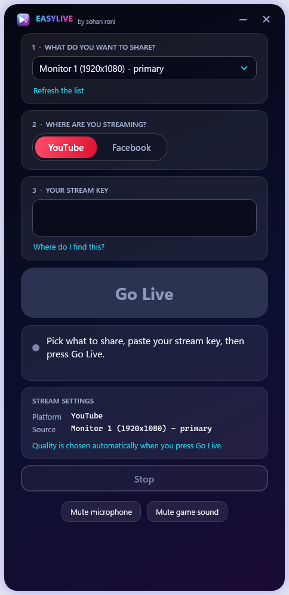
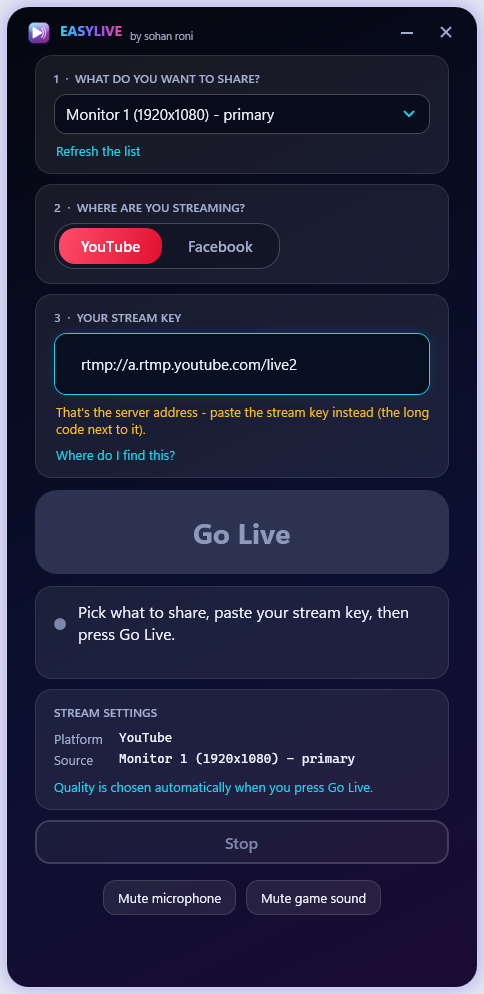
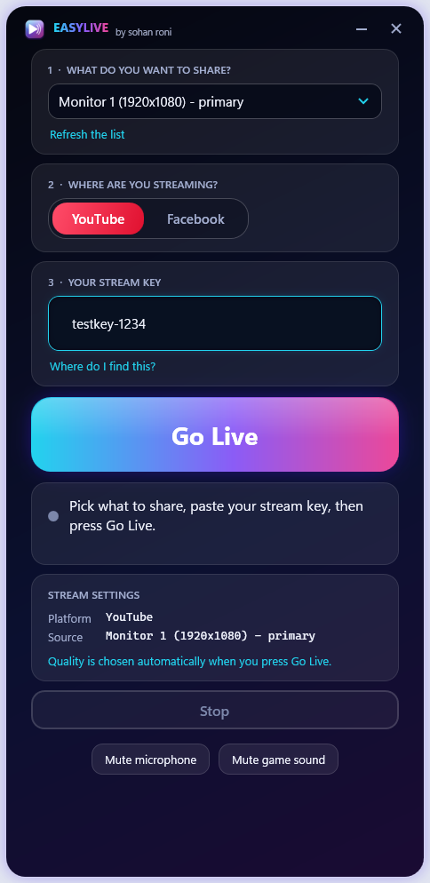
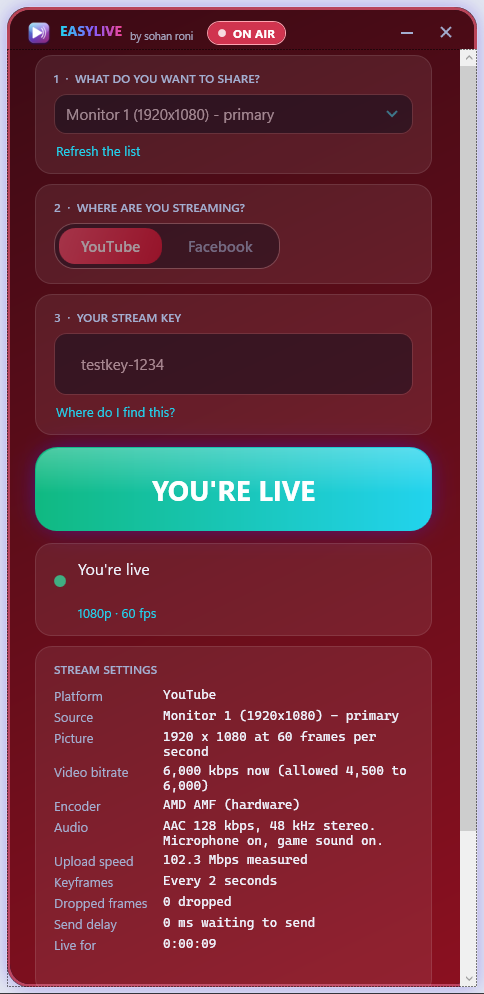
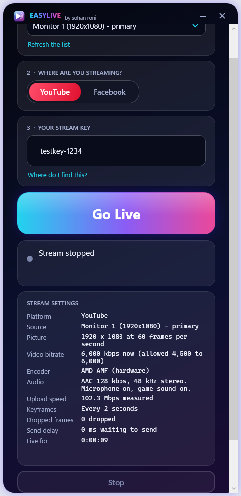

# EasyLive User Guide

**EasyLive by Sohan Roni** - version 1.0.0

Share your screen live on YouTube or Facebook. No tricky settings. This guide is for everyone, even if you have never streamed before.

## 1. What EasyLive does

EasyLive sends a live picture of your screen (or one window, like a game) to YouTube or Facebook. Your viewers watch it on your channel or page. It also sends your game sound and, if you want, your voice from the microphone.

EasyLive picks the picture quality for you. If your internet gets slow, it lowers the quality by itself, so your stream keeps going.

## 2. What you need

- A **Windows 10 or Windows 11** PC.
- An **internet connection with good upload speed**. Upload speed is how fast you can *send* things. A few Mbps is the minimum. More is better. If it is too slow, EasyLive will tell you.
- A **YouTube** or **Facebook** account that can go live.
  - **YouTube:** the first time you turn on live streaming, YouTube can take **up to 24 hours** before it lets you stream. Turn it on a day before you need it.
  - **Facebook:** make sure you are allowed to go live from your profile or page.

## 3. Install EasyLive

1. Double-click **EasyLive-Setup-1.0.0.exe**.
2. Windows may show a blue box that says **"Windows protected your PC"**. This is normal. EasyLive is new and is not "code-signed" yet. It does not mean something is wrong. Click **More info**, then click **Run anyway**.
3. Follow the steps in the Setup window. Click **Next**. You do not need an administrator password.
4. Leave **"Create a shortcut on the desktop"** ticked if you want an icon on your desktop.
5. On the last page, leave **Launch EasyLive** ticked and click **Finish**.
6. If **Windows Firewall** asks a question the first time you stream, choose **Allow**. EasyLive needs the internet to send your stream.

## 4. Get your stream key

A **stream key** is like a password for your live show. It tells YouTube or Facebook that the video is from you. You get it from the website, and then paste it into EasyLive.

**Keep your key secret.** Anyone who has it can stream to your channel. Never post it or show it on screen.

### On YouTube

1. Sign in to YouTube in your web browser.
2. Open **YouTube Studio**.
3. Look for a **Create** button or a **Go live** button. Click it.
4. Look for the **Stream** tab (it may be called "Stream" or "Streaming software").
5. Look for **Stream key**. There may be a button to show or copy it. Copy the key.
6. If you do not see anything about live streaming, live streaming may not be on yet. Turn it on and wait up to 24 hours.

### On Facebook

1. Sign in to Facebook in your web browser.
2. Open **Facebook Live Producer**. In EasyLive, click **Where do I find this?** to open the right page.
3. Look for **Streaming software** and choose it.
4. Look for **Stream key**. Copy it.
5. **Facebook keys work only once.** Next time you go live, get a new key from Facebook and paste it again.

Do not copy the "server URL" or "server address". It is a long web address that starts with `rtmp`. EasyLive already knows it. You only need the **key**.

## 5. Go live, step by step

Open EasyLive from the Start menu or the desktop icon. Look for the purple EasyLive logo and the words *by sohan roni* at the top.

1. **What do you want to share?** Click the first box and pick a **screen** (shown as "Monitor") or a **window** (like your game). If your window is not in the list, open it first, then click **Refresh the list**.
2. **Where are you streaming?** Click **YouTube** or **Facebook**.
3. **Your stream key.** Paste your key into the box. Press **Ctrl + V** to paste.

   If you paste the wrong thing, EasyLive shows a small yellow note to help you.

   

4. When all three are filled in, the big **Go Live** button lights up.

   

5. Press **Go Live**. EasyLive checks your computer and internet. This takes a few seconds. Then it says **You're live**.

### When you are live

The whole window turns **red**. A red **ON AIR** tag appears at the top, next to the EasyLive name, and the big button says **YOU'RE LIVE**. The red color is a reminder: people can see your screen right now. Be careful what you open.

Go to YouTube or Facebook in your browser to see your show. It may take 10 to 30 seconds for the picture to appear there. This delay is normal.

**On YouTube** you may need to press the **Go live** button on the YouTube page too, if YouTube asks you.

### To stop

1. Press **Stop** in EasyLive. The red color and the **ON AIR** tag go away and it says **Stream stopped**.
2. **Then end the broadcast on YouTube or Facebook too.** Stopping EasyLive stops sending video, but the show on the website may still say "live" for a little while.

## 6. Mute buttons

At the bottom of the window are two buttons.

- **Mute microphone** - viewers cannot hear your voice. Press it again to turn your voice back on.
- **Mute game sound** - viewers cannot hear the sounds from your computer (game, music, videos). Press it again to turn the sound back on.

You can press them before you go live and while you are live.

## 7. What the "Stream settings" card means

This card shows what EasyLive chose for you. You do not need to change anything. It is here in case you are curious.

| Line | What it means |
|---|---|
| Platform | YouTube or Facebook. |
| Source | The screen or window you are sharing. |
| Picture | How big the picture is and how many pictures per second ("frames per second"). More frames make motion look smoother. |
| Video bitrate | How much video data is sent each second ("kbps"). More data means a sharper picture. EasyLive raises and lowers this by itself, inside the range shown. |
| Encoder | The part of your computer that makes the video small enough to send. "Hardware" (Intel, AMD or NVIDIA) is best. "Software" uses your main processor and keeps quality lower. |
| Audio | The sound quality, and whether your microphone and game sound are on or muted. |
| Upload speed | How fast your internet could send data when EasyLive checked. |
| Keyframes | How often a full picture is sent. Platforms like it every 2 seconds. |
| Dropped frames | Pictures that were skipped. A small number is fine. A growing number means your internet or PC is struggling. |
| Send delay | How long video waits before it is sent. A number that keeps growing means your internet is too slow. |
| Live for | How long you have been live. |

## 8. If something goes wrong

EasyLive tells you in plain words. Find your message in this table.

| What you see | What it means | What to do |
|---|---|---|
| **Paste your stream key first** | The key box is empty. | Copy your stream key from YouTube or Facebook and paste it. See section 4. |
| **That's the server address - paste the stream key instead (the long code next to it).** | You pasted the server address, not the key. | Copy the **Stream key** instead. |
| **The key can't contain spaces - copy just the stream key.** | Your paste has spaces in it. | Copy only the key, with nothing else. |
| **That doesn't look like a stream key.** | The text is not a key. | Go back to YouTube or Facebook and copy the key again. |
| **No internet connection** | Your PC cannot reach the internet. | Check your Wi-Fi or cable. Open a website to test. Then press Go Live. |
| **Could not connect — check your internet connection.** | EasyLive could not reach YouTube or Facebook. | Check your internet and try again in a minute. |
| **Your upload speed is too slow to stream** | Your internet cannot send enough data. | Move closer to the router or use a cable. Close other things using the internet (downloads, other streams, videos). Try again. |
| **The platform did not accept your stream key — paste a new key.** | The key is wrong, old or turned off. | Get the key again from the website. Make sure live streaming is on (YouTube can take up to 24 hours the first time). |
| **Facebook did not accept the stream key. Facebook keys work only once, so paste the new key from Facebook Live Producer, then press Go Live.** | Facebook keys cannot be used twice. | Open Facebook Live Producer, get a new key, paste it, and press Go Live. |
| **Nothing to stream — the screen or window you picked isn't showing a picture. If it's minimized, bring it back and press Go Live again.** | The window you picked is hidden or minimized. | Click the window in your taskbar to bring it back. Then press Go Live. |
| **Your game is minimized — bring it back to continue.** | You minimized the window while live. | Bring the window back. The stream carries on. |
| **Your screen is showing only black — if you're sharing a game, run it in borderless or windowed mode.** | Some games in full-screen mode cannot be captured. | Change the game's display setting to **Borderless** or **Windowed**, or share the whole screen instead. |
| **The window you were sharing was closed.** | You closed the window. | Open it again, click **Refresh the list**, pick it and press Go Live. |
| **The screen or window you picked could not be captured.** | Windows did not let EasyLive see it. | Pick a different window, or share the whole screen. |
| **Reconnecting…** | Your internet dropped for a moment. | Wait. EasyLive tries again every few seconds for up to 2 minutes. You do not have to do anything. |
| **The connection could not be restored — the stream has stopped. Check your internet and press Go Live again.** | The internet was gone for too long. | Fix your internet and press **Go Live**. On Facebook, get a new key first. |
| **The connection to the platform was lost.** | YouTube or Facebook closed the connection. | Press Go Live again. |
| **Microphone not found — streaming game sound only.** | No microphone is plugged in. | Plug one in, or carry on without it. |
| **Microphone disconnected — streaming game sound only.** | The microphone was unplugged. | Plug it back in, or carry on without it. |
| **Game sound capture stopped.** | EasyLive lost the computer's sound. | Press Stop, then Go Live again. |
| **Your computer's sound could not be captured.** | Windows did not give EasyLive the sound. | Check that your speakers or headphones work, then try again. |
| **Your computer could not start the video encoder.** | The video part failed to start. | Close other programs that use the video card, then try again. Update your graphics driver if it keeps happening. |
| **Streaming components are missing — please reinstall EasyLive.** | Some of EasyLive's files are gone. | Run **EasyLive-Setup-1.0.0.exe** again. Your saved key is kept. |
| **Streaming stopped unexpectedly. / Something went wrong...** | An unknown problem. | Press Go Live again. If it keeps happening, restart EasyLive or your PC. |
| **EasyLive could not save your stream key on this computer.** | Windows would not let EasyLive save the key. | You can still stream. You will need to paste the key each time. |

**Other tips**

- The stream looks choppy? Close other programs, and pause downloads on other devices at home.
- Viewers do not hear you? Check that the mute buttons are not pressed.
- Nothing shows on YouTube or Facebook? Wait up to 30 seconds. On YouTube, check that the live page says it is receiving your video.

## 9. Privacy

- **Your stream key stays on this PC.** EasyLive saves it in a file called `keys.json` in this folder: `%LOCALAPPDATA%\EasyLive` (usually `C:\Users\<your name>\AppData\Local\EasyLive`). The key is scrambled with your Windows account, so other users on the PC cannot read it.
- EasyLive sends your key **only to YouTube or Facebook**, to start your stream.
- EasyLive sends your screen and sound **only to the platform you chose**.
- Before you go live, EasyLive does a short internet speed check. It sends random test data to a public speed-test server (Cloudflare). No personal information and no key are sent.
- EasyLive has no accounts, no ads and no tracking.
- A small log file (with keys hidden) is kept in the same folder, to help fix problems.

## 10. Uninstall

1. Open Windows **Settings**, then **Apps**, then **Installed apps**.
2. Find **EasyLive**, click the three dots, and choose **Uninstall**.
3. Setup asks: **Do you also want to remove your saved settings?** Choose **Yes** to delete your saved stream keys too. Choose **No** to keep them for later.

## 11. Credits

**EasyLive by Sohan Roni.**

EasyLive uses free, open-source software, including FFmpeg, OpenH264, NAudio, Vortice.Windows and the .NET runtime. Their licences and notices are in the EasyLive folder:

- `THIRD-PARTY-NOTICES.txt`
- the `LICENSES` folder

By default, that folder is `%LOCALAPPDATA%\Programs\EasyLive`.

